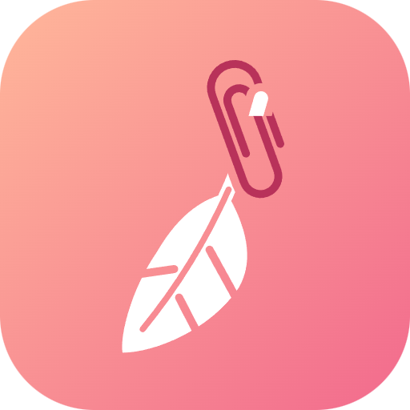

<div align="center">



# Pinfeather

Local clipboard history for Windows

[简体中文](README.md)

<p align="center">
  <a href="https://github.com/paralcor">
    <picture>
      <source media="(prefers-color-scheme: dark)" srcset="assets/brand/paralcor-horizontal-dark.png">
      
    </picture>
  </a>
  <br>
  <sub>Pinfeather is a product of the PARALCOR brand.</sub>
</p>

</div>

## The name

The Chinese name, 片羽 (piàn yǔ), means a single feather: light enough to pick up without a thought, and to drift elsewhere on the wind.

It comes from the idiom 吉光片羽. Even one feather left by the Jiguang, a mythical beast, was a treasure, so the phrase came to mean small fragments that are precious. Most of the sentences, links and images you copy every day are fragments like that.

片羽 also sounds like 片语, "a few words". That is what a clipboard carries: a few words passing through your fingertips.

The English name, **Pinfeather**, is a new feather just coming in on a young bird, still wrapped in its sheath. And on a clipboard, `pin` is the action that keeps something important in place.

## Current status

- **Capture and search.** Start or pause capture manually. Keep text, links, and supported formats from the source app. Search by text and preview long entries on demand. Star entries and use Show favorites only to filter the list.
- **Quick panel.** Press `Ctrl+Alt+V`, enter a search term, press Down to browse, and press Enter to copy plain text. The panel closes after a successful copy. Press `Ctrl+V` in the target app. Select text entries across searches, reorder them, and copy them as one block while keeping the panel open.
- **PNG images.** Preview a thumbnail and use Copy image to put the original PNG on the clipboard. Enter still copies text on entries that contain both formats. Both copy buttons keep the preview open.
- **Local management.** Set app exclusions, delete individual unstarred entries, clear unstarred history, and back up saved history. Restore a backup to a new data directory. [History management and recovery (Chinese)](rumo_clipboard_handoff/docs/pinfeather_personal_history.md)
- **Known limits.** The source and destination apps must support the registered PNG clipboard format. The full IME and app compatibility matrix and performance acceptance are pending.

## Run and verify

On Windows with Node.js, the Rust MSVC toolchain, C++ build tools, and WebView2, run these commands from the repository root. Capture starts paused by default. The main window lets you opt in to restoring the last manual capture state for the current data directory. Use `--start-paused` to force a paused start.

```powershell
npm ci
.\tools\dev.ps1 -DataDir '<absolute path to an isolated data directory>'
```

Run `npm test` and `npm run build` for frontend checks. See the [contributing guide](CONTRIBUTING.md#构建与检查) for Rust tests, desktop builds, and checks by area. See the [run guide (Chinese)](rumo_clipboard_handoff/docs/pinfeather_development.md) for desktop clipboard, quick panel, and restart checks.

## Contributing

- [Project handoff](rumo_clipboard_handoff/docs/pinfeather_project_handoff.md) (Chinese): product direction, roadmap and technical review
- [UI prototype](design/prototype/README.md) (Chinese): screens and interactions you can open in a browser, and the libraries to build them with
- [Contributing guide](CONTRIBUTING.md): rules for issues and pull requests

Suggestions are welcome as [issues](https://github.com/paralcor/pinfeather/issues/new/choose). Please report security problems privately as described in [SECURITY.md](SECURITY.md).

