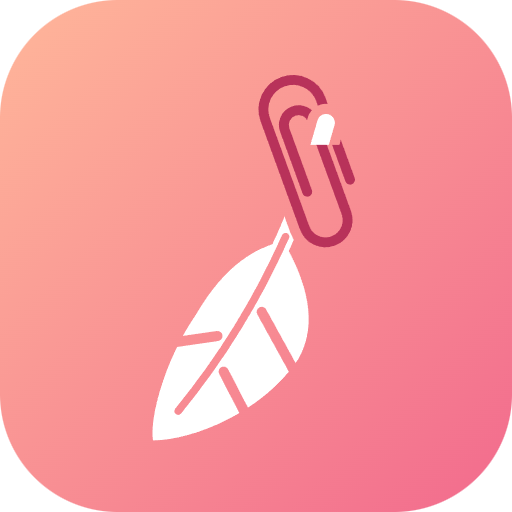

<div align="center">



# 片羽 Pinfeather

Windows 本地剪贴板历史

[English](README.en.md)

<p align="center">
  <a href="https://github.com/paralcor">
    <picture>
      <source media="(prefers-color-scheme: dark)" srcset="assets/brand/paralcor-horizontal-dark.png">
      
    </picture>
  </a>
  <br>
  <sub>片羽是帕拉珂 / PARALCOR 品牌下的产品。</sub>
</p>

</div>

## 名字

片羽，即一片羽毛——很轻，随手就能拾起，也能随风落向别处。

词源取自「吉光片羽」。传说中的神兽吉光，纵使只留下一片毛羽也成珍宝，常用来比喻零碎却珍贵的事物。你日常复制过的句子、链接与图片，大多也是这样的碎片。

「片羽」亦谐音「片语」。剪贴板所承载的，正是流转于指尖的只言片语。

英文名 **Pinfeather** 原指幼鸟初生、尚裹在羽鞘里的新羽；而在剪贴板里，`pin` 恰好也是把重要内容「固定留存」的动作。

## 当前状态

- **收录与检索**。手动开始或暂停收录，保存文字、链接以及来源应用提供的受支持格式。按正文关键词搜索历史，按需预览长文。
- **快捷面板**。按 `Ctrl+Alt+V` 打开面板，输入搜索词，按 ↓ 进入结果，按 Enter 复制纯文本。复制成功后面板收起，回到目标应用按 `Ctrl+V` 粘贴。
- **PNG 图片**。条目带 PNG 时可查看缩略图，用「复制图片」写入原始 PNG。图文条目的 Enter 仍复制文字。点「复制图片」或「复制纯文本」后，面板留在预览。
- **本地管理**。设置应用排除规则，删除选中的条目或清空历史。已保存的历史可备份并恢复到新数据目录。[历史管理与恢复](rumo_clipboard_handoff/docs/pinfeather_personal_history.md)
- **已知限制**。来源应用须提供注册的 PNG 格式，目标应用须能粘贴该格式。完整输入法与应用兼容矩阵，以及性能验收仍待完成。

## 启动与验证

在装有 Node.js、Rust MSVC 工具链、C++ 构建工具和 WebView2 的 Windows 环境中，从仓库根目录运行。收录默认在启动时暂停。可在主窗口为当前数据目录开启「启动时恢复上次手动收录状态」；`--start-paused` 可强制本次启动暂停。

```powershell
npm ci
.\tools\dev.ps1 -DataDir '<本次隔离数据目录的绝对路径>'
```

前端检查运行 `npm test` 和 `npm run build`。桌面 Release 构建、Rust 测试及按改动范围选择的验收项见[贡献指南](CONTRIBUTING.md#构建与检查)。实际剪贴板、快捷面板和重启验收见[运行指南](rumo_clipboard_handoff/docs/pinfeather_development.md)。

## 参与

- [交接文档](rumo_clipboard_handoff/docs/pinfeather_project_handoff.md)：产品方向、版本路线和技术评审
- [界面原型](design/prototype/README.md)：用浏览器打开就能看的界面和交互，以及实现用的库
- [贡献指南](CONTRIBUTING.md)：提 issue 和 PR 的规则

欢迎用 [issue](https://github.com/paralcor/pinfeather/issues/new/choose) 提建议。安全问题请按 [SECURITY.md](SECURITY.md) 私下报告。

