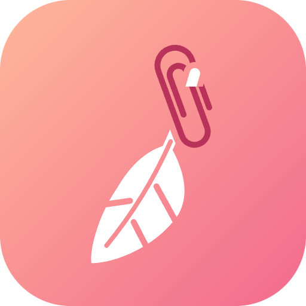

# 片羽 Pinfeather

新一代剪贴板工具，正在规划中

[English](README.en.md)

## 名字

片羽，即一片羽毛——很轻，随手就能拾起，也能随风落向别处。

词源取自「吉光片羽」。传说中的神兽吉光，纵使只留下一片毛羽也成珍宝，常用来比喻零碎却珍贵的事物。你日常复制过的句子、链接与图片，大多也是这样的碎片。

「片羽」亦谐音「片语」。剪贴板所承载的，正是流转于指尖的只言片语。

英文名 **Pinfeather** 原指幼鸟初生、尚裹在羽鞘里的新羽；而在剪贴板里，`pin` 恰好也是把重要内容「固定留存」的动作。

## 计划

片羽还在规划中，目前没有可用的版本。计划中的方向：

- **收集**：随手留下复制过的文字、链接和图片
- **检索**：很久以前复制的东西，也能很快找回来
- **流转**：在一台设备上复制，在另一台设备上粘贴
- **理解**：识别复制内容的类型，需要时帮你整理、翻译或改写

## 参与

- [交接文档](rumo_clipboard_handoff/docs/pinfeather_project_handoff.md)：产品方向、版本路线和技术评审
- [界面原型](design/prototype/README.md)：用浏览器打开就能看的界面和交互，以及实现用的库
- [贡献指南](CONTRIBUTING.md)：提 issue 和 PR 的规则

欢迎用 [issue](https://github.com/paralcor/pinfeather/issues/new/choose) 提建议。安全问题请按 [SECURITY.md](SECURITY.md) 私下报告。

---

  <a href="https://github.com/paralcor">
    <picture>
      <source media="(prefers-color-scheme: dark)" srcset="assets/brand/paralcor-horizontal-dark.png">
      
    </picture>
  </a>
   
  片羽是帕拉珂 / PARALCOR 品牌下的产品。

